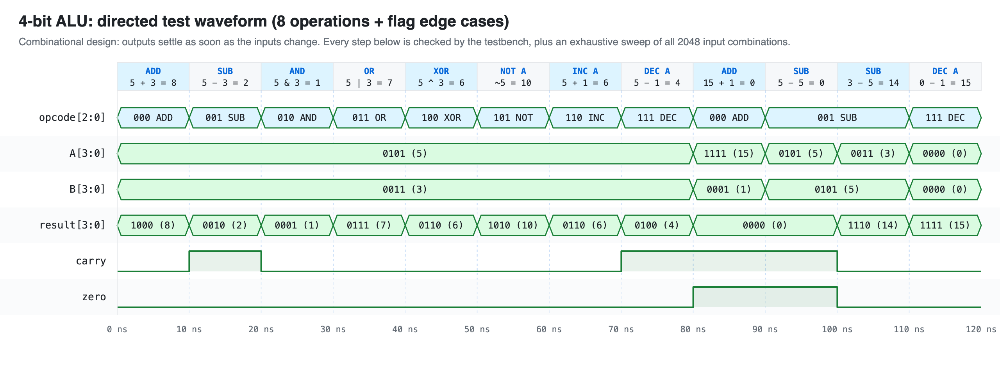

# 4-bit ALU in Verilog

A combinational 4-bit Arithmetic Logic Unit written in synthesizable Verilog. It supports 8 arithmetic and logic operations and has **carry** and **zero** status flags. It is verified by a self-checking testbench that compares the ALU with a reference model on **every possible input combination**.

- **Operations:** ADD, SUB, AND, OR, XOR, NOT, INC, DEC (selected by a 3-bit opcode)
- **Flags:** `carry` (carry-out, or "no borrow" for subtraction) and `zero` (set when the result is 0)
- **Verification:** 12 directed tests plus an exhaustive sweep of 8 opcodes × 16 × 16 inputs, for **2060/2060 checks passed**

## Waveform

The directed tests: one step per operation, followed by the overflow, zero-flag, borrow and underflow edge cases.



A vector (SVG) version is in [`docs/`](docs/).

## Block diagram

```
            ┌──────────────────────┐
  A[3:0] ──►│                      │──► result[3:0]
  B[3:0] ──►│      alu_4bit        │──► carry
opcode[2:0]►│   (combinational)    │──► zero
            └──────────────────────┘
```

## Opcode table

| Opcode | Operation | Result | `carry` |
|:------:|-----------|--------|---------|
| `000` | ADD   | A + B       | carry-out of bit 3 |
| `001` | SUB   | A − B (computed as A + ~B + 1) | 1 = no borrow (A ≥ B), 0 = borrow |
| `010` | AND   | A & B       | 0 |
| `011` | OR    | A \| B      | 0 |
| `100` | XOR   | A ^ B       | 0 |
| `101` | NOT A | ~A          | 0 |
| `110` | INC A | A + 1       | carry-out (A = 15 wraps to 0) |
| `111` | DEC A | A − 1 (computed as A + 1111) | 1 = no borrow, 0 when A = 0 wraps to 15 |

`zero` is set whenever `result == 0000`, for every operation.

Subtraction uses **two's complement**: the ALU adds the inverted B plus 1. This reuses the adder, and is how real CPUs (ARM, 6502) implement subtraction. In this convention `carry = 1` means *no borrow*.

## Simulation results

```
--- Directed tests ---
PASS  ADD A=0101( 5) B=0011( 3) -> result=1000( 8) carry=0 zero=0
PASS  SUB A=0101( 5) B=0011( 3) -> result=0010( 2) carry=1 zero=0
PASS  AND A=0101( 5) B=0011( 3) -> result=0001( 1) carry=0 zero=0
PASS  OR  A=0101( 5) B=0011( 3) -> result=0111( 7) carry=0 zero=0
PASS  XOR A=0101( 5) B=0011( 3) -> result=0110( 6) carry=0 zero=0
PASS  NOT A=0101( 5) B=0011( 3) -> result=1010(10) carry=0 zero=0
PASS  INC A=0101( 5) B=0011( 3) -> result=0110( 6) carry=0 zero=0
PASS  DEC A=0101( 5) B=0011( 3) -> result=0100( 4) carry=1 zero=0
PASS  ADD A=1111(15) B=0001( 1) -> result=0000( 0) carry=1 zero=1
PASS  SUB A=0101( 5) B=0101( 5) -> result=0000( 0) carry=1 zero=1
PASS  SUB A=0011( 3) B=0101( 5) -> result=1110(14) carry=0 zero=0
PASS  DEC A=0000( 0) B=0000( 0) -> result=1111(15) carry=0 zero=0
--- Exhaustive test (all opcodes, all A, all B) ---
ALL TESTS PASSED (2060/2060 checks)
```

## Files

| File | Description |
|------|-------------|
| [`alu_4bit.v`](alu_4bit.v) | The ALU: one `always @(*)` block with a `case` on the opcode, using a 5-bit intermediate result to capture the carry. |
| [`alu_4bit_tb.v`](alu_4bit_tb.v) | Self-checking testbench with a reference-model function, directed tests (dumped to the VCD) and an exhaustive sweep. |
| [`scripts/vcd_to_svg.py`](scripts/vcd_to_svg.py) | Converts the simulation VCD into the waveform image above (needs only Python 3, no other packages). |

## Running it

Requires [Icarus Verilog](https://steveicarus.github.io/iverilog/). [GTKWave](https://gtkwave.sourceforge.net/) is optional, for browsing the waveforms interactively.

```bash
make sim     # compile and run the testbench (writes alu_4bit.vcd)
make wave    # regenerate docs/alu_waveform.svg from the VCD
make view    # open the VCD in GTKWave
make clean
```

Or run it without make:

```bash
iverilog -o alu_sim alu_4bit.v alu_4bit_tb.v
vvp alu_sim
```

## Possible extensions

- Signed overflow flag (`V`) and negative flag (`N`) for two's-complement arithmetic
- Shift and rotate operations (would need a 4-bit opcode)
- Parameterized width (`N`-bit ALU)
- Combine it with a register file and a control unit to build a simple CPU datapath

## Tools

Verilog HDL · Icarus Verilog · GTKWave · Python
